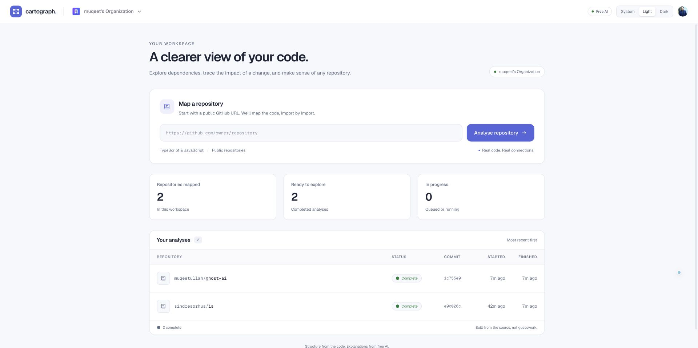
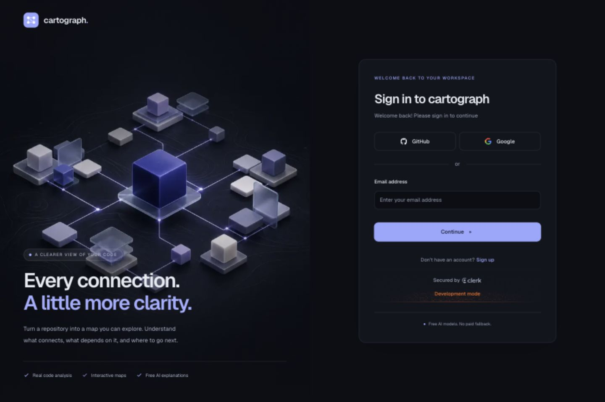

<div align="center">

# Cartograph

### See the connections. Understand the code.

An interactive workspace for exploring JavaScript and TypeScript repositories through real dependency maps, impact analysis, and free AI explanations.

**Customized and maintained by [Muqeet Ullah Ghazi](https://github.com/Muqeetullah)**

[Live website](https://cartograph-weld.vercel.app) · [Features](#features) · [Local setup](#local-setup) · [Deployment](#deployment) · [Credits](#credits)

</div>



## Overview

Cartograph turns a public GitHub repository into a map of its files and imports. Open folders, inspect modules, follow dependency chains, and see which files depend on the code you want to change.

The map comes from source-code parsing. AI explains the stored facts and can suggest a role for an unclassified file; it does not create the graph's nodes or edges.

This version includes a redesigned responsive workspace, illustrated authentication pages, accessible map controls, and an OpenRouter integration restricted to a specific free coding model.

## Features

- **Repository mapping:** analyze public JavaScript and TypeScript repositories at a recorded commit.
- **Interactive canvas:** expand folders, select files, filter by category, zoom, and fit the map to the screen.
- **Impact analysis:** inspect imports, dependents, dependency chains, and a file's blast radius.
- **Route discovery:** inspect routes recovered by the framework adapters, with omissions reported rather than guessed.
- **Graph insights:** identify dependency cycles, heavily imported modules, long files, and files without importers.
- **AI explanations:** request file and folder explanations using the parsed structure and source context.
- **Cached answers:** reuse previous answers without another model request.
- **Team workspaces:** sign in with Clerk and keep analyses scoped to the active organization through Supabase row-level security.
- **Analysis progress:** follow repository fetching, file selection, parsing, and storage through Supabase Realtime.
- **Responsive interface:** light and dark themes, mobile layouts, keyboard-accessible folder controls, and illustrated sign-in/sign-up cards with loading states.

## Built with

| Layer | Technology |
| --- | --- |
| Application | Next.js 16 App Router, React 19, TypeScript 5 |
| Styling | Tailwind CSS 4, Geist fonts |
| Graph rendering | React Flow and Dagre |
| Source analysis | ts-morph and the TypeScript compiler API |
| Authentication | Clerk with Organizations |
| Database and progress | Supabase Postgres, row-level security, Realtime |
| AI | OpenRouter through the OpenAI-compatible SDK |
| Optional tracing | LangSmith, disabled by default |
| Hosting | Vercel Hobby |

Framework adapters include Next.js, React, Express, NestJS, Docusaurus, and a generic fallback. Exact route recovery depends on the framework and on paths being statically readable from the source.

## Local setup

### 1. Install prerequisites

Use **Node.js 24.x**, **Git**, and **pnpm 10.32.1**, the package-manager version recorded in this repository. You will also need Clerk and Supabase projects. AI features need an OpenRouter API key.

```bash
git clone https://github.com/Muqeetullah/cartograph.git
cd cartograph
pnpm install --frozen-lockfile
cp .env.example .env.local
```

The repository is private, so cloning requires access to the GitHub account or repository.

### 2. Configure environment variables

Fill in `.env.local` with your own values:

```dotenv
# Clerk
NEXT_PUBLIC_CLERK_PUBLISHABLE_KEY=your_clerk_publishable_key
CLERK_SECRET_KEY=your_clerk_secret_key
NEXT_PUBLIC_CLERK_SIGN_IN_URL=/sign-in
NEXT_PUBLIC_CLERK_SIGN_UP_URL=/sign-up
NEXT_PUBLIC_CLERK_SIGN_IN_FALLBACK_REDIRECT_URL=/
NEXT_PUBLIC_CLERK_SIGN_UP_FALLBACK_REDIRECT_URL=/

# Supabase
NEXT_PUBLIC_SUPABASE_URL=https://your-project.supabase.co
NEXT_PUBLIC_SUPABASE_PUBLISHABLE_KEY=your_supabase_publishable_key
SUPABASE_SECRET_KEY=your_supabase_secret_key

# Free AI
OPENROUTER_API_KEY=your_openrouter_key

# Optional tracing remains off
LANGSMITH_TRACING=false
```

Keep secret keys on the server. `.env.local` and other local environment files are excluded from Git and deployment uploads. Variables beginning with `NEXT_PUBLIC_` are intended for the browser.

The legacy `AGENT_URL` entry in `.env.example` is not used by the included application. No separate agent service is required.

### 3. Configure Clerk and Supabase

1. Enable **Organizations** in Clerk.
2. Activate Clerk's **Supabase integration**.
3. In Supabase's **Authentication → Sign In / Providers → Third-Party Auth**, add the matching Clerk issuer URL.
4. In Clerk's session-token customization, add the organization name claim, preserving the integration's managed authentication role:

   ```json
   {
     "org_name": "{{org.name}}"
   }
   ```

5. Apply the eight SQL files in `supabase/migrations/` in filename order to a fresh Supabase database. They create the tables, policies, functions, and progress broadcasts required by the app. Use your database migration tooling or the SQL editor; do not rerun the full sequence against an already migrated database.

The database policies use the organization ID in the Clerk token. Supplying API keys alone does not configure this authentication connection or create the database schema.

### 4. Start the app

```bash
pnpm dev --hostname localhost
```

Open [localhost:3000](http://localhost:3000), sign up or sign in, and paste a public GitHub repository URL into **Map a repository**.

For a local production build:

```bash
pnpm build
pnpm start --hostname localhost
```

## Free AI configuration

Both explanation and classification currently use:

```text
poolside/laguna-s-2.1:free
```

The model selection and request boundary live in `lib/ai/client.ts`:

- Only configured model IDs are accepted.
- OpenRouter provider prompt and completion prices are capped at zero.
- There is no paid fallback.
- Requests time out after 45 seconds and do not retry automatically.
- Free-provider rate limits are reported to the user.
- Cache keys include the model and prompt version, preventing old answers from being reused after those change.

The OpenAI-compatible SDK is only the API client; an OpenAI API key is not required. LangSmith tracing is optional and is off in this deployment.

Free-model availability and service quotas can change. If the configured endpoint is unavailable, update the code to another suitable free model after checking its capabilities. AI explanations can still contain mistakes or speculation; the parsed graph remains the source of structural facts.

## Checks and development tools

```bash
pnpm test     # AI request-boundary and caching regression tests, with a mocked provider
pnpm lint     # ESLint
pnpm build    # Production build and TypeScript checking
```

The automated tests do not make live AI requests or consume API credits.

The parser and graph checks can also run without authentication or AI credentials:

```bash
pnpm parse . --out /tmp/cartograph-analysis.json
pnpm map-counts /tmp/cartograph-analysis.json
pnpm insights /tmp/cartograph-analysis.json
```

To run the database-backed analysis pipeline from the command line:

```bash
pnpm analyze https://github.com/owner/repository --org YOUR_CLERK_ORGANIZATION_ID
```

That last command uses the configured database and writes an analysis to the specified organization.

## Deployment

**Live application:** [cartograph-weld.vercel.app](https://cartograph-weld.vercel.app)

The project is connected to this GitHub repository and deployed in the `muqeetullahs-projects` Vercel workspace. The production branch is `main`.

For a separate deployment:

1. Import your copy of the repository into Vercel.
2. Select the **Next.js** framework preset and Node.js **24.x**.
3. Add the variables from the setup section to the Vercel project before deploying.
4. Use the committed `vercel.json` configuration for installation and building.
5. Verify the sign-in/sign-up routes and the Clerk–Supabase connection on the deployed domain.

The current deployment uses Vercel's **Hobby** plan. Repository parsing and post-response work are configured within its 300-second function duration limit. Large repositories can exceed free runtime, memory, or service quotas. The app downloads public repository archives without a GitHub token, so GitHub's unauthenticated limits also apply.

Clerk currently uses development-instance keys, and its **Development mode** label remains visible. This repository does not purchase domains, enable paid plans, or upgrade providers automatically.

## Project structure

```text
app/                  Pages, layouts, authentication routes, server actions
components/           Dashboard, auth cards, map, details, progress controls
lib/ai/               Free model client, prompts, caching-aware AI tasks
lib/analysis/         Stored graph loading and explanation context
lib/graph/            Folding, reachability, highlighting, graph insights
lib/parser/           Source walking, import resolution, framework adapters
lib/pipeline/         GitHub archive retrieval and analysis persistence
lib/supabase/         Server, browser, and admin database clients
public/images/        Custom authentication illustration
scripts/              Parser, graph, and pipeline command-line tools
supabase/migrations/  Database schema, security policies, progress functions
tests/                Automated regression tests
```

## Authentication preview



## Credits

**Muqeet Ullah Ghazi** — customization and maintenance of this version, including the refreshed workspace interface, illustrated authentication experience, free-model integration, testing improvements, and deployment.

- GitHub: [@Muqeetullah](https://github.com/Muqeetullah)
- Project: [Muqeetullah/cartograph](https://github.com/Muqeetullah/cartograph)

This version builds on the original [Cartograph project by Adrian Hajdin / JavaScript Mastery](https://github.com/adrianhajdin/cartograph). Credit for that original foundation remains with its authors.
